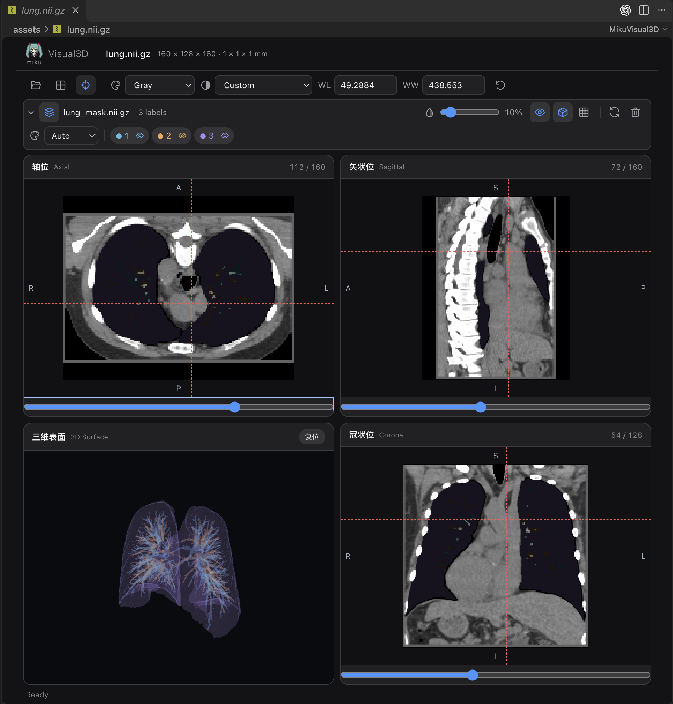

# Miku Visual3D

在 VS Code 中查看 NIfTI 医学影像与分割 Mask，支持本地和 Remote-SSH 工作区。

*肺部 CT 与 Mask 实际界面：轴位、矢状位、冠状位联动，结合标签叠加与三维表面查看结构。*

## 功能

- 轴位、矢状位、冠状位与三维四窗联动，支持切换布局。
- 固定放射学显示方向：轴位、冠状位左 R 右 L，矢状位左 A 右 P；方向未知或斜切时保留相应提示。
- 窗宽窗位预设、手动调窗、Gray、Gray Inverted、Bone、Viridis、Plasma、Turbo 等 14 种颜色映射。
- 多份 Mask 对比、标签自动配色、显隐、不透明度、实体与线框显示。
- 标签选择与定位，同步跳转三个切面并聚焦三维结构。
- 文件读取、解压和表面提取在工作区主机执行，客户端只接收切片与网格。

## 使用

1. 在扩展面板选择 **Install from VSIX…**，安装 `builds/miku-visual3d-1.0.0.vsix`，然后重载窗口。
2. 右键 `.nii` / `.nii.gz` → **Open With… → Miku Visual3D**，或运行 **MikuVisual: Open Image**。
3. 使用工具栏文件夹图标继续加载文件；已有影像时，也可右键文件选择 **MikuVisual: Add Image**。
4. Remote-SSH 下，将插件安装到 SSH 主机，并从远程资源管理器打开文件。

| 操作 | 交互 |
| --- | --- |
| 切片与联动 | 滚轮 / 切片滑块；点击影像定位 |
| 窗宽窗位 | 预设菜单、WL / WW 输入框或右键拖动 |
| 标签选择与定位 | 单击标签选中，双击标签跳转 |
| Mask 显隐 | 眼睛图标控制整份 Mask 或单个标签 |
| 三维视角 | 左键旋转、右键平移、滚轮缩放；“复位”恢复相机 |

作者：[eejyang](https://github.com/eejyang) · [GitHub](https://github.com/eejyang/miku-visual3d) · [问题反馈](https://github.com/eejyang/miku-visual3d/issues)

许可：[BSD-2-Clause](LICENSE)；第三方许可见 [THIRD_PARTY_NOTICES](THIRD_PARTY_NOTICES)。
